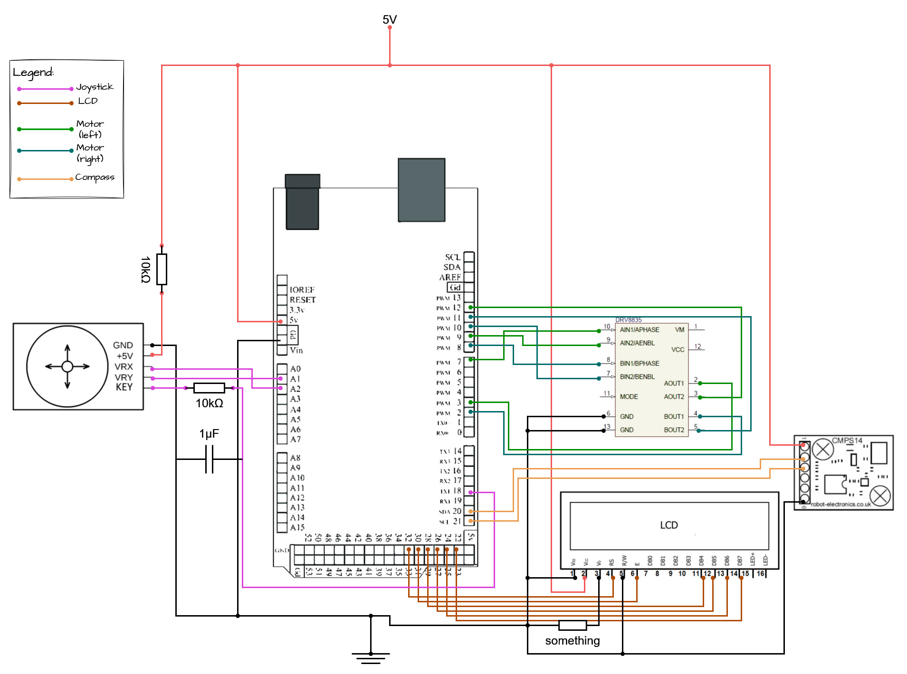

# Smart-Vehicle
A remote-controlled, Arduino-based smart vehicle designed for flexible navigation. This vehicle can either follow a predetermined route or be manually controlled. It leverages a tilt-compensated compass for directional accuracy, wheel encoders to measure travel distance, and LIDAR for real-time obstacle detection and avoidance. Through these integrated systems, the Smart-Vehicle provides an adaptable, sensor-driven platform suitable for robotics experimentation.

## Section Links:
- List of tasks that need focusing on: [To-Do](#to-do).
- List of all components used in vehicle: [Components](#components).
- Circuit diagrams: [Schematics](#circuits).

## To-Do
- [ ] Check if adding inductor (coil L) can fix compass on startup
- [ ] Fix compass module to be flat on vehicle
- [ ] Figure out calibration issue on power up
- [ ] Finish exercise 6 of week 43 lab
- [ ] Create frontend website 
- [ ] Communicate controls from frontend to backend
- [x] Create circuit schematic for mega
- [ ] Check if possible to house all components on Arduino Nano

## Components
### **If using _Arduino Mega_**:
- Arduino Mega 2560 Rev3
- 20x4 Character LCD 
- Dual Axis Joystick Module
- Pololu DRV8835 Dual Motor Driver Shield
- 2 x Lego NXT Electric Motor
- CMPS14 Tilt Compensated Compass Module
- LIDAR-Lite V3 *
- ESP32 / ESP8266 *

*(find out what module we will use)

### **If using _Arduino Nano_**:
- Arduino Nano
- Pololu DRV8835 Dual Motor Driver Shield
- 2 x Lego NXT Electric Motor
- CMPS14 Tilt Compensated Compass Module
- LIDAR-Lite V3 *
- ESP32 / ESP8266 *

*(find out what module we will use)

### Links to buy components:
- [Arduino Mega 2560 Rev3](https://store.arduino.cc/en-fi/products/arduino-mega-2560-rev3)
- [Arduino Nano](https://store.arduino.cc/en-fi/products/arduino-nano)
- [20x4 Character LCD](https://www.aliexpress.com/item/1005006336849899.html)
- [Dual Axis Joystick Module](https://www.aliexpress.com/item/1005006403673836.html)
- [Pololu DRV8835 Dual Motor Driver Shield](https://www.pololu.com/product/2511)
- [Lego NXT Electric Motor](https://www.brickowl.com/catalog/lego-nxt-electric-motor-53787)
- [CMPS14 Compass Module](https://www.robotshop.com/products/tilt-compensated-magnetic-compass-cmps14)
- LIDAR-Lite V3 *
- ESP32 / ESP8266 *

*(find out what module we will use first)

## Circuits

### Circuit using Arduino Mega
Current missing motors, ESP, LIDAR:

### Circuit using Arduino Nano
TBA (if possible)
